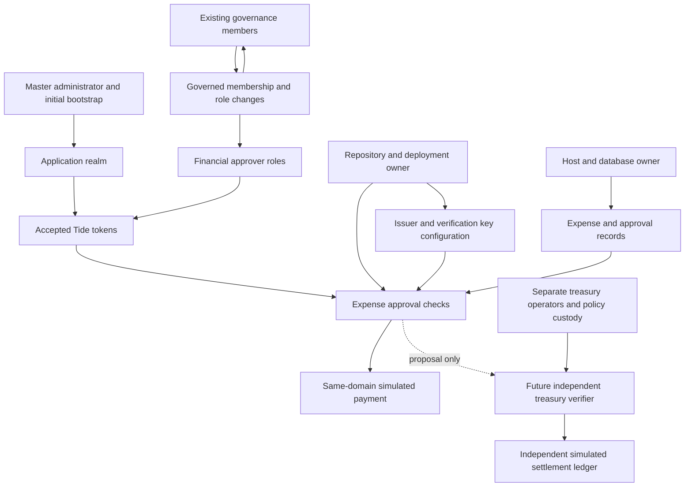
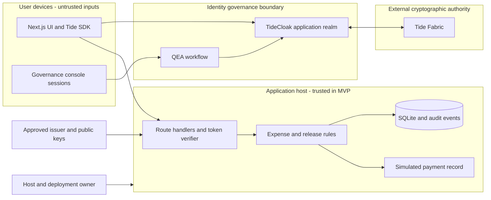
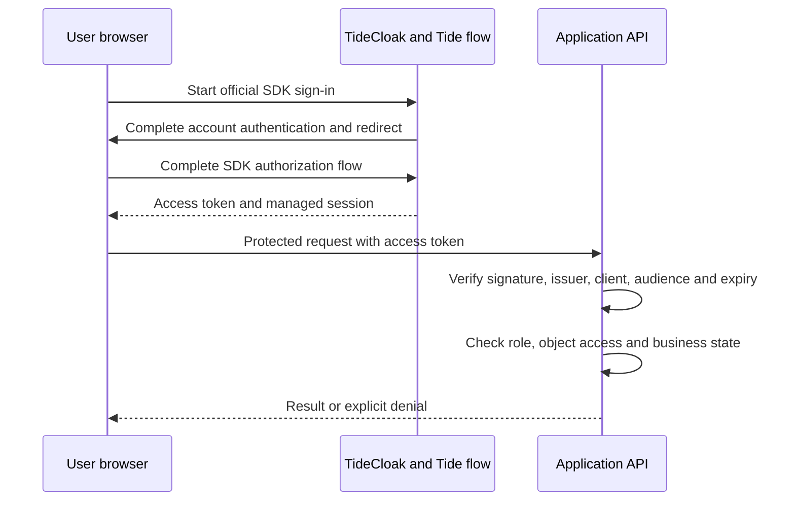
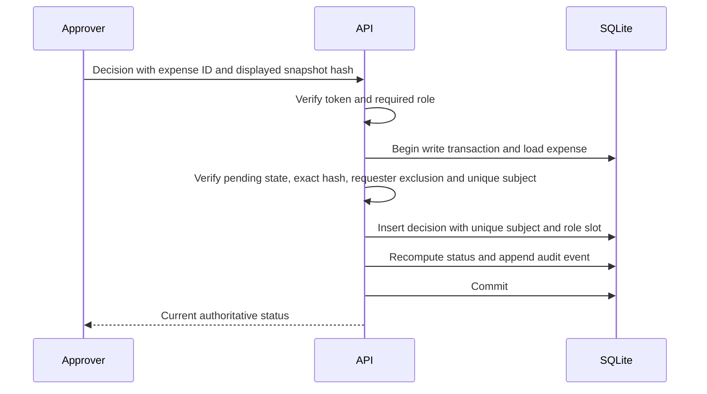
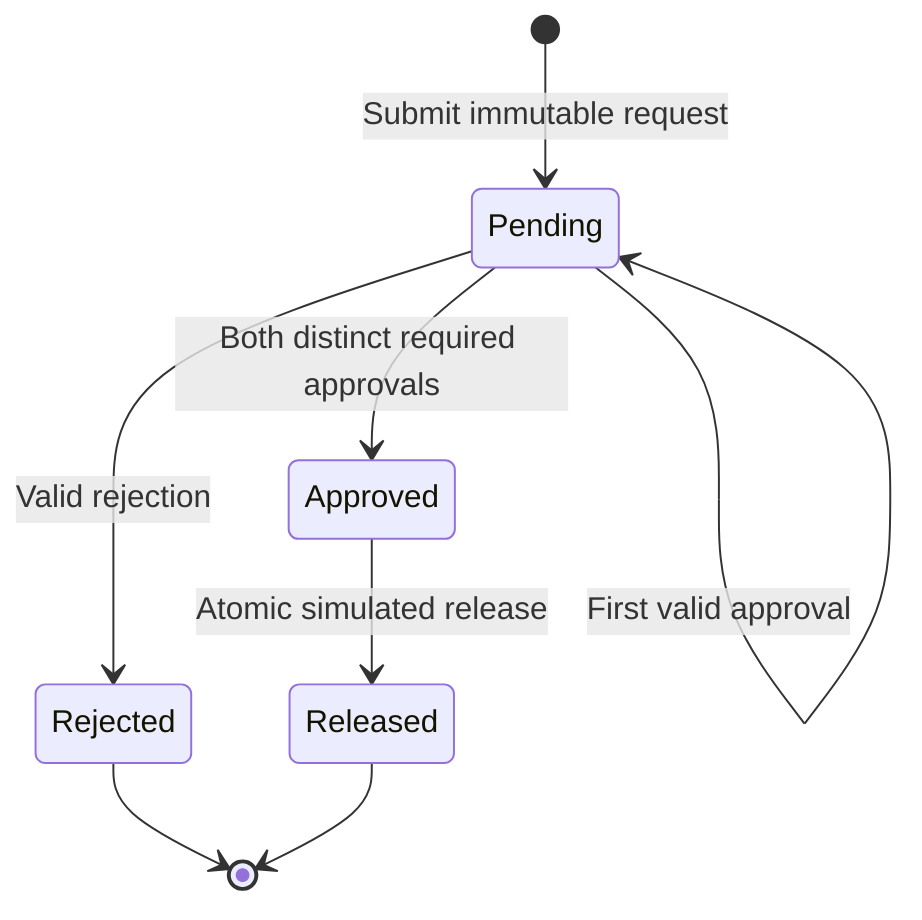

# Dual-Control Expense Desk — implementation plan for approval

Planning only. No application code, infrastructure, accounts, or repository has been created. Research checked on 22 October 2026. Documentation-backed capabilities below are not claims of successful runtime testing.

## A. Executive Summary

Build a small expense workflow whose distinctive feature is governing **who may become an approver**. The proposed MVP uses genuine TideCloak authentication and QEA for financial-role governance, with ordinary server-side expense checks. It demonstrates a narrower, defensible promise: an ordinary administrator cannot manufacture financial approval authority alone in the tested, three-administrator realm.

It does **not** establish that a compromised backend, host administrator, master-realm administrator, or valid malicious governance quorum cannot cause a simulated payment. Those are separate authorities. The recommended submission must state this boundary.

### The five authority questions

1. **Who approves expenses?** A designated department manager and a different finance manager, authenticated through TideCloak and authorized by verified financial-role claims. Neither may be the requester. Recommend requiring both for every MVP expense; defer the below-$500 exception.
2. **Who grants or revokes that authority?** The financial roles belong to the application realm. Administrators propose changes; the configured QEA process must authorize them before they become effective. Human reviewers must also verify who owns the proposed account. Authentication does not prove employment or distinct human ownership.
3. **Who changes the permission rules?** Realm governance controls the governed IAM configuration; deployers control application rules and token-verification configuration; infrastructure operators control the running systems. Master-realm administration is a separate privileged exception. These powers must not be conflated.
4. **What if they are compromised?** One ordinary administrator should be unable to grant a protected role under the tested configuration. A stolen approver account can exercise that approver's legitimate powers. A sufficient governance coalition can authorize malicious grants. A compromised deployer can remove application checks. A compromised database operator can fabricate application records.
5. **What independently stops a compromised governance quorum from paying?** **Nothing in the recommended P0 MVP.** A treasury role managed by the same quorum and checked by the same backend is another workflow step, not an independent trust domain. A separate payment simulator with independently controlled credentials, policy, ledger, deployment and transaction approval could contain that attack, but should be deferred unless its separation is actually demonstrated.

The business value is allowing small organizations to delegate account administration without also delegating unilateral control of financial approver membership. The originality must come from the authority analysis and honest attack demonstration: this exact project name is already an inspiration example on the challenge website, so do not pitch the name or generic expense workflow as novel. [Official challenge and example configuration](https://tide.org/unlocked/config.js).

## B. Hackathon Feasibility Assessment

### Verified deadline and available time

The official page and its configuration give Vietnam's deadline as **22 October 2026, 18:00 ICT (UTC+7)**. This is region-specific; do not convert the Melbourne deadline and use that instead. The public repository must include the working source and a two-minute MP4 below 100 MB, with a README project overview of no more than 300 words. The judging weights match your brief: 25/20/20/20/15. [Submission requirements](https://tide.org/unlocked/#submit), [regional deadlines and judging configuration](https://tide.org/unlocked/config.js).

Clock checkpoint: **11:55:51 ICT**, equivalent to 04:55:51 UTC. Remaining at that checkpoint: **6 hours, 4 minutes, 9 seconds**. Subtract time spent reviewing this plan. The workspace was empty when inspected.

Use **17:30 ICT as the submission target**, preserving 30 minutes for upload/form problems. Freeze features at 16:15 and code at 16:45. This leaves roughly four hours for a working build, followed by verification, recording and delivery. The roadmap assumes approval near noon and three to five people already comfortable with web development. It is aggressive, not a guarantee.

### Feasibility judgment

| Scope | Judgment | Why |
|---|---|---|
| Real login, protected API, expense form, two approvals | Feasible if initial integration succeeds within 45 minutes | Small application, familiar stack |
| Three real QEA administrators and a blocked role grant | Essential, moderate integration risk | Enrollment, licensing and actual governance behavior are the critical path |
| Six separate polished screens | Unnecessary | Combine dashboard/submission and detail/approval/release |
| Custom QEA dashboard | Remove | Use Tide's existing console |
| Independent treasury trust domain | High schedule risk | Requires separate operators, infrastructure and authoritative payment state |
| Custom Forseti payment contract | Future work by default | New policy/deployment surface and transaction-verification tests |
| Production-grade financial security | Not feasible today | Identity proofing, recovery, deployment governance and independent enforcement remain |

**Go/no-go:** by 12:45, prove login plus a protected API and have the governance enrollment path working. By 13:15, prove the unilateral grant stays ineffective. If either fails, stop adding UI features and resolve integration. A decorative mock of QEA cannot replace this evidence.

## C. Authority Control Matrix

### Domains and interpretation

- **I — IAM governance:** application-realm QEA administrators and Tide-backed authorization.
- **B — business application:** Next.js process, policy and SQLite.
- **O — operations:** host, source repository, CI, secrets, runtime and DNS.
- **M — master administration:** highest-level TideCloak administration and bootstrap.
- **T — independent treasury:** proposed future service with its own operators, identities and ledger.
- **U — user devices:** individual users' accounts, browsers and recovery channels.

The following is a proposed allocation, not a claim that fine-grained administrative restrictions have already been configured. “QEA” means only the particular operation has passed the governance coverage tests in section J. An API's existence does not prove its governance.

| Authority / operation | Responsible identity and domain | Grant / revoke authority | Authentication and enforcement | Unilateral power, independent control and compromise consequence |
|---|---|---|---|---|
| 1. Create ordinary users | Account operator, I | Realm administrators configure operator permissions | Linked user enrollment; authorized admin operation | May create unprivileged accounts alone. No default financial roles. Fake users remain possible. |
| 2. Disable/delete users | Account operator, I | Realm governance; M remains privileged | Admin permissions; verify capture separately | Assume possible unilateral availability attack until tested. Disable preferred to deletion; retain audit identities. |
| 3. Grant financial roles | QEA administrators, I | Existing governance appoints administrators | Governed role mapping, then verified role in fresh token | Intended two-of-three control. A valid malicious quorum can grant fraudulent authority. |
| 4. Revoke financial roles | QEA administrators, I | Same as grants | Governed removal; token expiry bounds stale rights | Quorum delay and already-issued tokens remain. Revocation is not retroactive cancellation of past approvals in P0. |
| 5. Appoint/remove security administrators | Existing QEA administrators, I; initial M bootstrap | Existing governed membership; bootstrap initially central | Enclave approval for governed admin-role change | Membership self-governance is recursive. A compromised sufficient coalition can perpetuate itself; test removal coverage. |
| 6. Change governance quorum | Membership governance, I; engine/config owners O/M | Membership affects computed threshold; arbitrary threshold-setting API unverified | Runtime QEA mechanism; configuration integrity | Do not invent a configurable 2-of-3 setting. Changes to membership or implementation affect security. |
| 7. Change amount threshold | Application policy maintainer, B/O | Repository/deployment owners | Reviewed code deployment; no policy editor in P0 | Deployer can change it. QEA does not automatically protect a TypeScript constant. P0 uses dual approval for all amounts. |
| 8. Change expense policy | Application maintainer, B/O | Repository/deployment owners | Server rules and tests | A deployer can remove checks. Branch review alone is not independent cryptographic enforcement. |
| 9. Approve/reject expense | Department/finance managers, U/I/B | Financial-role governance | Verified token plus object/state checks and atomic DB write | One can fill one slot, never both. Collusion or multiple attacker-owned identities can defeat human independence. |
| 10. Release simulated payment | Manager-triggered simulator in P0, B; treasury role in P1 | I controls P1 treasury role; O controls code | Server checks all required approvals; atomic unique release | No independent defense against I quorum plus fraudulent approvers or B/O compromise. Future T must own actual release. |
| 11. Set/change beneficiary | Requester at creation, U/B | Submit permission; no post-submission edit authority in P0 | Server validation and immutable transaction snapshot | No supported edit after submission. DBA/deployer can bypass; a replacement request needs new approvals. |
| 12. Modify application database | Runtime and database/host operators, B/O | Host/cloud account owners | Filesystem/database access controls | Host operator can alter all application records. DB constraints only constrain normal writes. |
| 13. Deploy code | Release maintainer, O | Repository/cloud organization owners | Source control and deployment credentials | Normally unilateral on a hackathon laptop. Can replace verification, UI and payment logic. |
| 14. Change TideCloak configuration | Realm governance for covered operations, I; host/master for others | I/O/M | QEA where covered; host/admin controls otherwise | Inventory every setting; no blanket coverage claim. Wrong issuer/JWK trust can invalidate the design. |
| 15. Highest-level IdP administration | Master administrator, M; host operator O | Bootstrap credential and host ownership/recovery | Master-admin authentication; operational custody | Master is documented outside QEA. Exact application-realm consequences must be tested, not assumed safe or all-powerful cryptographically. |
| 16. Modify/bypass enforcement | Deployers O, master M, DB operator B/O; future T operator | Respective infrastructure owners | Independent verifiers only where actually deployed | O can bypass application checks without forging any Tide token. Separate T would limit this only if O cannot change T. |
| 17. One authority compromised | Any single role/domain | Incident response and surviving governance | Revocation, freeze and recovery procedures | Impact is domain-specific: user misuse, admin denial of service, or complete app compromise for deployer. |
| 18. Entire quorum compromised | Sufficient I administrators | Surviving quorum may no longer be trustworthy | Valid governed changes can still pass | Financial membership protection fails. Independent T is the proposed containment; absent in P0. |

Tide documents the threshold as `max(1, floor(0.7 × N))`: N=1→1, 2→1, 3→2, 4→2, 5→3. Therefore use **three independently enrolled administrators**, not two. The same document explicitly exempts the master realm. [Governance model](https://docs.tide.org/Core-Concepts/iga-workflow).

### Authority dependency diagram



### Circular and common-mode risks

Governance electing its own successors is a real authority loop. Bootstrap begins with one trusted person; adding nominal accounts does not retroactively make the bootstrap independent. All accounts sharing one laptop, password manager, recovery mailbox, browser profile or operator are one compromise domain. Separate containers on one host do not establish independence from the host owner. Separate realms do not help if the same master, recovery credentials or deployer controls both. A treasury signing key in the app's environment is still under application operations. Fetching verification keys from a replaceable endpoint can allow a host to substitute an issuer/key even when it cannot extract Tide's legitimate signing key.

## D. Threat Model

Assets: approver membership, exact expense content, valid approvals, release uniqueness, audit history, user sessions, governance configuration and service availability. All transactions and beneficiaries are fictional. The adversary can use direct APIs, not merely visible UI controls.

Severity describes impact; likelihood is qualitative for a rushed prototype, not a measured probability. C=critical, H=high, M=medium; likelihood H/M/L. Coverage below is **planned**, with no runtime tests yet executed.

### Attack paths

| ID | Scenario and objective | Capabilities and entry point | Boundary and attack sequence | Severity / likelihood |
|---|---|---|---|---|
| T01 | Compromised employee seeks reimbursement | Employee session; submit API | U→B: create false expense, probe another user's records, try own approval | H / H |
| T02 | Compromised department manager approves fraud | Valid manager session; decision API | U→B: approve accomplice request or try both approval slots | H / M |
| T03 | Compromised finance manager approves fraud | Valid finance session; decision API | U→B: fill finance slot, impersonate department authority in body | H / M |
| T04 | Compromised treasury authorizer releases fraud | Treasury session; P1 release API | U→B/T: release unapproved item or substitute beneficiary | H / M |
| T05 | Malicious legitimate administrator manufactures authority | Account-admin UI/API | I→financial authority: create controlled users, assign roles, approve fraud | C / M |
| T06 | One compromised QEA administrator | One enclave/admin session | I governance: propose role grant, approve once, force commit | C / M |
| T07 | Compromised governance quorum | Two of three admin identities | I→B: approve fraudulent grants, add allies, manufacture both expense approvals | C / M |
| T08 | Legitimate approvers collude | Two real authorized accounts | Business intent boundary: both knowingly approve fabricated expense | H / M |
| T09 | Fake accounts under one attacker | Enrollment invitations and account creation | Identity→human independence: create two accounts, seek two roles | H / H |
| T10 | Unauthorized role assignment through alternate path | Admin REST, group/composite/default role changes | Admin API→effective claims: indirect grant avoids visible role screen | C / H |
| T11 | Approval threshold weakened | Policy API/config or deploy access | O→B: lower threshold or remove finance requirement | C / M |
| T12 | Frontend bypass | Any token; direct HTTP client | Browser→API: call hidden approve, release or audit routes | H / H |
| T13 | Forged/replayed decision | Captured request, modified claims or valid token | U→B: forge role, resubmit decision, race parallel requests | H / H |
| T14 | Expense modified after approval | Edit API or DB write | Approved snapshot→release: increase amount or replace description | C / M |
| T15 | Beneficiary substituted | Request parameter, UI or DB access | Approved recipient→payment: keep approval but change destination | C / M |
| T16 | Database manipulation | SQLite/host write access | O→B: insert approvals, set released, rewrite log | C / M |
| T17 | Backend/deployment compromised | Code execution or deployment credential | O→all app enforcement: bypass verifier and release directly | C / M |
| T18 | Token theft | Browser compromise, XSS, leaked logs | U session→API: reuse valid bearer credentials before expiry | H / H |
| T19 | Highest-level TideCloak compromise | Master credential or server control | M→I: alter realm/configuration, attempt local issuer substitution or bypass | C / M |
| T20 | Security configuration replaced | Environment/CI/config access | O→verification: replace issuer/JWK, widen algorithms, weaken origins | C / M |

### Controls, actual enforcers and tests

| ID | Mitigation and actual enforcement component | MVP coverage and residual risk | Practical acceptance/characterization test |
|---|---|---|---|
| T01 | API ownership checks and requester exclusion; managers review evidence | Partial: blocks unauthorized actions, not lying about a purchase | Employee creates own request; self-approval denied; another employee's record unreadable |
| T02 | API distinct-subject check and required finance slot; DB uniqueness | Partial: valid manager can still endorse fraud | Manager action alone leaves request pending; same person cannot fill finance slot |
| T03 | API requires department approval independently | Partial: collusion remains | Finance-only decision stays pending; client-supplied department role ignored |
| T04 | P1 API recomputes eligibility and checks treasury subject distinct from requester/approvers | P1 only; same governance/backend remains common authority | Treasury attempts release before both approvals; deny without payment row |
| T05 | Restrict operator rights; QEA for effective financial grants | Conditional on QEA coverage and absence of master/host powers | Complete attacker chain; fake accounts never obtain effective role after lone approval |
| T06 | Tide QEA capture/enclave/commit; app verifies effective claims | Conditional; single admin may still disrupt service | One vote followed by commit fails below quorum; fresh token lacks new role |
| T07 | Separate T domain in future; no equivalent P0 defense | **Not mitigated** once malicious grants succeed | In disposable realm, satisfy actual threshold and show grants become effective; label outcome accurately |
| T08 | Independent business evidence and treasury review in future | **Not mitigated** by distinct account IDs | Two valid approvers approve invented expense; P0 accepts it as a known limit |
| T09 | Human verification before grants, independent enrollment and recovery | Partial/process control; no Sybil-resistant identity proof in MVP | New accounts receive no financial permissions; reviewer examines proposed owner |
| T10 | Govern all effective mapping routes; remove broad defaults/composites | Conditional until each route tested | Try direct role API, group membership, composite roles, default roles and client scopes; inspect fresh token and protected API |
| T11 | No threshold mutation endpoint; fixed dual-approval rule | Blocks ordinary API users; deployer can change code | Modified threshold body rejected; deliberate code change demonstrates remaining operational authority |
| T12 | Authenticate and authorize every protected route at operation time | Planned P0 | Direct POST with wrong role returns 403; release remains absent |
| T13 | Signature verification, exact snapshot match, unique subject and role slot; transaction lock | Planned P0; stolen live bearer remains usable | Tamper JWT; replay request; send simultaneous duplicate/distinct decisions; no extra approval or release |
| T14 | Immutable submitted content; snapshot digest verified before decisions/release | Planned P0 for normal API; DBA can rewrite everything consistently | Reject mutation; change one DB field without digest update and detect mismatch; document full DB rewrite vulnerability |
| T15 | Recipient included in immutable snapshot; server ignores no destination override | Planned P0 for API; infrastructure compromise remains | Swap recipient at release; reject; no payment for new recipient |
| T16 | DB permissions, backups; independent signed evidence/ledger in future | **Not mitigated** against full DB owner | Insert forged approval rows on disposable copy; document ability to deceive app |
| T17 | Separate release enforcement in future | **Not mitigated** against deployer/RCE | Demonstrate threat by design review or isolated mutation test; never claim Tide login protects arbitrary app code |
| T18 | Short tokens, HTTPS, no token logging, safe text rendering, restrictive origins | Partial; no general bearer replay resistance | Stolen valid token characterization, expired-token rejection, logout/refresh behavior measured |
| T19 | Separate master custody, pinned trust config, no master token accepted by app | Partial operational control; QEA bypass scope unresolved | On disposable realm, exercise master operations and measure effective fresh claims and app acceptance |
| T20 | Server-only vetted verifier config; approved key material; review config changes | Partial; same deployer can replace verifier | Wrong issuer, wrong client/audience, attacker key and unapproved algorithm all rejected |

Prioritize T05/T06/T10/T12/T13/T14/T15/T20 for release-blocking tests. T07/T16/T17/T19 are release-blocking **claim boundaries**: the submission must disclose them even if destructive characterization cannot be completed.

### The two central attacks

**A — one administrator:** allow creation of an unprivileged fake identity; attempt a financial grant; obtain only one governance approval; verify the role remains ineffective; call the approval API using a freshly authenticated fake user; observe denial. The blocking chain is QEA for effective role authority and the API's verified-role check for the expense action. A “pending” badge alone is not proof.

**B — sufficient quorum:** grant both financial roles to attacker-controlled identities through valid governance, then use two distinct accounts to approve fraud. The system is following authorized policy, despite malicious intent. Existing governance can potentially authorize additional governed privileges and membership changes; exact membership-removal, policy-change and key-operation scope must be tested. It cannot be assumed to extract private keys, impersonate arbitrary users, or own server deployments merely because it governs roles. It does not need those capabilities to authorize fraudulent expenses in this design.

RBAC itself is not inherently inadequate: a conventional system can also use independent governance and external enforcement. The weakness is concentrating role administration and enforcement under a single authority. The claimed Tide advantage must be its actual externally enforced, cryptographically governed authority path, not simply counting two approvals in an application table.

## E. Security Architecture

### Recommended three-layer interpretation

| Layer | P0 implementation | What it establishes | What it does not establish |
|---|---|---|---|
| 1. Identity and permission governance | Tide-backed realm, three governance administrators, tested QEA role mappings | Covered membership changes require the observed quorum | Unique humans, honest quorum, complete master/host immunity |
| 2. Business approval | Next.js server + SQLite transaction | Two distinct authorized subjects approve the exact immutable request | Cryptographic proof of each user's transaction intent; resistance to DB/deployer compromise |
| 3. Payment release | Clearly labeled same-domain simulator | Normal API cannot release before required approvals | Independent treasury authority or real settlement security |

Application approval rows are ordinary records. A Tide authentication token proves authenticated claims within its validity and trust configuration; it is not a signature by that person over this expense. QEA governs covered administrative changes. Distributed signing authority protects operations actually bound to it. Independent transaction authorization additionally requires binding the exact payment and enforcing that evidence at the settlement boundary.

Tide describes cryptographic operations performed through distributed key shares rather than a signing key held by the application server. This is the architectural distinction from an application that merely increments an approval counter. It does not imply that arbitrary application database writes become externally enforced. [Tide architecture concepts](https://docs.tide.org/Core-Concepts/core-concepts).

### A credible independent treasury extension

The smallest meaningful extension would be a separate simulator on a treasury-controlled machine/account, with its own authoritative release ledger and separately enrolled treasury credentials. It accepts a payment proposal containing the exact amount, currency, beneficiary, expense ID, policy version, digest and one-use nonce. Treasury reviews that proposal on a UI the app operator cannot replace. The simulator requires treasury authorization, checks its own policy and records the nonce atomically before issuing a receipt.

The app can display a forged “paid” label, but cannot create an accepted receipt in this separate ledger. Demo the authoritative treasury ledger, not only the app's status. Treasury must check business evidence independently if claiming resistance to fabricated application approval rows; trusting `approved: true` from the compromised app is insufficient.

Separate deployment ownership, credential recovery, key custody, policy updates, allowlisted beneficiaries and ledger backups are part of this control. If the same team member controls both machines or can reset the treasury identity, describe the demo as an architectural simulation, not demonstrated organizational independence. A hardware-backed key helps resist extraction but does not prevent its legitimate holder signing a malicious payment or a quorum enrolling an attacker's new key.

Forseti is a documented possible future enforcement route: C# policies can validate request data and authorization before a protected cryptographic operation. Feasibility still requires proving transaction-field binding, replay handling, distinct approvers, governance over policy replacement and an external receiver that refuses unsigned requests. Do not assume generic policy support supplies a complete expense-payment contract. [Programmable policy engine](https://docs.tide.org/Core-Concepts/forseti-engine).

### Security invariants and owners

| Invariant | Enforcer | Who can undermine it |
|---|---|---|
| Only valid application-realm tokens reach protected operations | Server verifier and pinned issuer/key configuration | App deployer/config owner |
| Covered financial grants cannot become effective below quorum | Tide QEA and its Fabric path | Valid malicious quorum; unverified privileged exceptions |
| Requester cannot approve; one subject occupies at most one slot | Server policy + DB unique constraints | Deployer or DB owner |
| All required slots refer to the exact request snapshot | Server canonicalization and digest comparison | Deployer/DB owner can rewrite records and hashes |
| Approval and release races cannot create duplicate outcomes | Single SQLite transaction and unique release constraint | DB owner or alternate unguarded writer |
| New accounts have no financial authority | IAM defaults, mappings and governance | Valid malicious quorum or untested mapping bypass |
| No real money or real personal data | Fictional fixtures and no banking integration | Scope change; not a cryptographic guarantee |
| Logs accurately support normal-path diagnosis | Transactional application event writes | Runtime/DB owner; logs are not tamper-resistant evidence |

## F. TideCloak Integration Plan

### Verified capabilities and unresolved details

| Topic | Documentation-backed finding | Decision / runtime verification |
|---|---|---|
| Realm bootstrap | Wizard creates a realm and links the initial administrator | Treat bootstrap as trusted setup; capture versions and configuration |
| User authentication | Next.js SDK supports login, logout and token refresh | Use official browser flow; do not build a password collector |
| Identity proofing | Account enrollment authenticates an account | Employment and independent ownership require separate human checks |
| Backend verification | Documented verifier returns validated claims or null | Verify inside API handlers; reject missing/invalid claims |
| Role claims | Verifier documents realm/client role extraction | Choose application client roles; test the precise emitted claim namespace |
| QEA coverage | Role mappings, composites/default roles and relevant scope changes are documented | Execute bypass tests on the deployed version; never infer every operation is governed |
| Admin API | Keycloak-compatible management surface exists | Use console for demo; raw API only for coverage tests |
| Programmable policy | Forseti documents custom cryptographic authorization | P2 unless a proven example works within a strict timebox |
| Agent tooling | Raziel serves read-only guidance | Optional aid, not a runtime enforcer or prerequisite |

Sources: [Quickstart](https://docs.tide.org/Admin/Quick-deploy-test), [Next.js SDK](https://docs.tide.org/Languages/NextJS/tidecloak-nextjs-intro), [QEA setup](https://docs.tide.org/Admin/SetupIGA), [Management API](https://docs.tide.org/API/Management%20API), [Raziel](https://tide.org/agent-plugins).

### Implementation steps after approval

1. **Provision a disposable development realm.** Use the official Docker quickstart, with a non-default bootstrap password, local-only admin exposure and persistent data. Record the resolved image digest and package versions once working. Do not publish credentials or use the example password. Complete enrollment/license setup and verify a real sign-in. [Deployment recipe](https://docs.tide.org/Admin/Quick-deploy-test).
2. **Establish governance.** Enroll three actual governance participants with separate sessions/recovery ownership. Finish bootstrap adoption requests before testing. Grant the governance role through the documented console flow; confirm effective membership and threshold. Avoid presenting the initial one-administrator period as protected. [QEA setup](https://docs.tide.org/Admin/SetupIGA).
3. **Register the application.** Use a dedicated client and exact allowed development/deployment origins and callback URLs. Use the official Next.js starter and provider/session flow. Use its supported refresh/logout behavior; document measured residual validity after logout. [Next.js integration guide](https://docs.tide.org/Languages/NextJS/tidecloak-nextjs-how-to-guide).
4. **Define minimal roles.** Proposed application role names: `employee`, `department-manager`, `finance-manager`; optional `treasury-authoriser`, `audit-reader`. These are our design names, not built-in Tide capabilities. Assign no financial role through registration defaults. Do not place realm-management or master credentials in Next.js.
5. **Verify at every protected API.** Use the documented `verifyTideCloakToken` integration. Its detailed reference describes issuer/signature/`azp` checks and role extraction; the overview also mentions audience. Explicitly test `aud` handling rather than assuming `azp` is equivalent. Require the intended API audience in the chosen configuration and reject tokens for another client. Pin the approved signing public-key set in server configuration if supported as documented; do not accept arbitrary replacement keys. Handle future rotation through an explicit reviewed update. [JWT verifier reference](https://docs.tide.org/Languages/NextJS/VerifyJWT).
6. **Prove governance on actual writes.** Propose a manager grant through the console and the standard role-mapping API, authorize below quorum, then inspect fresh claims and call the app. Also test default/composite/group paths and relevant client settings. [Admin endpoints and governance annotations](https://docs.tide.org/API/Admin%20API%20Reference).
7. **Complete a legitimate governed grant.** Finish the required approvals, obtain a fresh user session/token and prove the same endpoint now succeeds. Keep evidence of both states. The QEA setup guide distinguishes authorization from commitment and explains that multi-administrator approvals involve the enclave; do not invent a plain REST shortcut to sign them. [QEA lifecycle](https://docs.tide.org/Admin/SetupIGA).
8. **Characterize privileged paths.** Use a disposable realm to test master administration, IdP replacement, role removal, member removal, local signing-provider changes and app verifier trust. If behavior cannot be established in time, limit the claim to tested ordinary-realm administrator actions.

The authentication API guide includes legacy `/auth` paths and password-grant examples; the management guide distinguishes modern and legacy deployments. Follow the actual realm discovery/configuration and official Next.js flow, not a guessed URL or copied password grant. [Authentication API](https://docs.tide.org/API/Authentication%20API), [deployment URL distinctions](https://docs.tide.org/API/Management%20API).

### Governance coverage checklist

Record each as tested/pass, tested/fail or unverified: direct client-role grant/removal; realm-role grant/removal if used; composites; default roles; group inheritance; admin-role grant/removal; client scopes/mappers/full scope; user disable/delete; IdP changes; governance disablement; offboarding; signing-provider changes; master-admin writes. No broad safety conclusion follows from a successful test of only one mapping path.

### Session policy

Use a proposed maximum five-minute access-token lifetime if supported by the deployment; measure the actual value. Reauthentication/refresh cannot be assumed to erase privileges from an already-issued token. In P0, accepted approvals record authority at decision time and survive later role revocation. Incident response therefore freezes releases and cancels affected requests; automatic retroactive invalidation is P2. Do not claim immediate revocation without testing it. DPoP is documented but not part of the baseline; sender constraint would require verification at the resource server as well as issuance support. [Next.js guide](https://docs.tide.org/Languages/NextJS/tidecloak-nextjs-how-to-guide).

## G. MVP Scope

### P0 — essential

- Genuine Tide-backed login and server verification.
- Three governance administrators and demonstrated ineffective lone financial-role grant.
- One organization, one department, fictional USD amounts represented as integer cents.
- Create an immutable expense with title, amount, category, description and fictional beneficiary.
- Dashboard and detail view; two distinct approval roles for **all** requests.
- Reject action, self-approval denial, duplicate/race protection and exact snapshot binding.
- Same-domain simulated release after approvals, prominently labeled as such.
- Basic audit events and an attack walkthrough using genuine outcomes.
- Security limitations, reproducible setup, tests, public repository and video.

### P1 — only after P0 evidence is captured

- Treasury-role release step, explicitly labeled **same governance domain**.
- Read-only audit filtering and clearer status design.
- Below-$500 single-manager branch, only if boundary tests pass and it adds demo value.
- Export test evidence and selected governance event identifiers.
- Independent treasury proof only if a separate operator/environment already exists and all section E acceptance conditions can be met before feature freeze.

### P2 — future work

- Independent release service and governed treasury key/policy lifecycle.
- Transaction-specific user signatures or validated Forseti signing policy.
- Hardware-backed approval and separately governed identity proofing.
- Tamper-evident evidence with independent anchoring and external verification.
- Strong deployment/configuration governance and recovery ceremonies.
- Sender-constrained sessions, automatic incident cancellation, advanced revocation.
- Multi-department policies, receipt upload, analytics, notifications and real payment integrations.

**Minimum viable fallback:** a single dashboard/detail page with a prefilled fictional request, real login, real server-checked role gating, two approvals and the real QEA console. Keep persistence and negative tests. Drop dedicated submit/audit/release screens, treasury role and visual polish. If real QEA cannot be demonstrated, describe the narrower login/RBAC prototype honestly; it may satisfy basic integration but does not prove the proposed authority claim and is substantially weaker for judging.

## H. Application Architecture

### Stack decision

Keep Next.js, TypeScript, Tailwind, route handlers, SQLite, Docker and GitHub. Use one Next.js application in the Node runtime, not edge runtime for database handlers. Keep SQLite on persistent local storage with one application instance; avoid ephemeral serverless hosting for this MVP. Docker is primarily for TideCloak; containerizing the app is optional if it delays the working demo. No queue, microservices, custom admin SDK, generic policy engine or new UI framework.

### Component and trust-boundary diagram



The boundary around the application explicitly includes payment simulation. Its host owner can modify every component inside it.

### Authentication sequence



Use the starter's protocol flow rather than implementing OIDC exchanges manually. Never trust roles, requester IDs or approval counts in the request body.

### Expense approval sequence



### QEA role-change sequence

```mermaid
sequenceDiagram
    participant A as Administrator A
    participant Q as Tide governance
    participant B as Administrator B
    participant U as Proposed approver
    participant API as Expense API
    A->>Q: Propose financial role mapping
    A->>Q: Authorize through supported flow
    Q-->>A: Below observed quorum; not effective
    U->>API: Attempt approval with fresh token
    API-->>U: Denied - financial role absent
    B->>Q: Review and authorize same change
    Q->>Q: Complete governed commitment at quorum
    U->>Q: Obtain fresh authenticated claims
    U->>API: Repeat permitted action
    API-->>U: Accepted if all business rules pass
```

### Release sequence

```mermaid
sequenceDiagram
    participant U as Authorized release caller
    participant A as Same-domain API
    participant D as SQLite
    U->>A: Release request for expense snapshot
    A->>A: Verify caller and optional treasury restrictions
    A->>D: Begin transaction; reload expense and decisions
    A->>A: Check exact snapshot and all required distinct approvals
    A->>D: Insert unique simulated payment and audit event
    A->>D: Mark released and commit
    A-->>U: Simulated receipt
    Note over A,D: This is not an independent treasury boundary
```

### Proposed database schema

No user passwords, master credentials or authoritative role table belong in the application database. Identify actors by the verified issuer plus subject, never email or display name. A local display-name cache is optional and non-authoritative.

| Table | Fields | Required constraints |
|---|---|---|
| `expenses` | `id`, requester issuer/subject, `title`, `amount_minor`, `currency`, `category`, `description`, `beneficiary_ref`, `policy_version`, `snapshot_hash`, `status`, `created_at` | Primary key; positive bounded integer amount; USD-only P0; status enumeration; required text bounds |
| `decisions` | `id`, `expense_id`, actor issuer/subject, `role_slot`, `decision`, `snapshot_hash`, `created_at` | Foreign key; unique `(expense_id, actor_issuer, actor_sub)`; unique `(expense_id, role_slot)`; allowed decision/slot values |
| `payments` | `id`, `expense_id`, `snapshot_hash`, releasing issuer/subject, `created_at`, `simulation_marker` | Unique expense ID; foreign key; simulation marker always true |
| `audit_events` | `id`, server time, actor issuer/subject or anonymous, action, target ID, outcome, reason code, correlation ID, snapshot hash | Append through application paths; no bearer tokens, secrets or unnecessary personal data |

Enable foreign-key enforcement explicitly. Use one write transaction to insert a decision, recompute status and append its successful event. Use the same atomic pattern for release. Bound lock waits; return a retryable conflict/service error rather than partial success. A replay returns the existing identical result or a 409 conflict and never creates another effect.

### Transaction binding

Define one canonical snapshot containing a domain label, expense ID, requester issuer/subject, integer amount, currency, title, category, description, beneficiary reference and policy version. Normalize and validate input **before** storing it. Compute SHA-256 over a deterministic ordered representation. Include the resulting digest in every decision and payment. Before accepting a decision, compare the submitted displayed digest with a fresh server computation. Before release, recompute and compare every accepted decision's digest.

No content-edit route exists after submission. Correction creates a new expense with no inherited decisions. This avoids revision logic in P0. Hashing binds normal application operations to a snapshot; a database attacker can rewrite content, hash and decisions together. It is not a user signature or tamper-proof storage.

### Proposed application API — these are our endpoints, not Tide APIs

| Method and path | Input | Permission and behavior | Result |
|---|---|---|---|
| `GET /api/me` | None | Valid token; return only needed subject/display/role data | 200 or 401 |
| `GET /api/expenses` | Bounded status filter | Employee sees own; managers see work queue; treasury sees eligible items if enabled | 200 scoped list |
| `POST /api/expenses` | Title, amount in minor units, category, description, fictional beneficiary | Employee role; derive requester from token; reject unknown authority fields | 201 immutable pending expense |
| `GET /api/expenses/{id}` | ID | Owner or permitted reviewer; object-level access check | 200 or 404 for inaccessible objects |
| `POST /api/expenses/{id}/decisions` | `role_slot`, `decision`, `snapshot_hash` | Verify matching role, pending state, distinct subject and not requester | 200 current status; 403 denial; 409 duplicate/stale/conflict |
| `POST /api/expenses/{id}/release` | `snapshot_hash` | P0 finance manager; P1 treasury role replaces this, with separation checks; recompute eligibility | 201 first simulated receipt; 200 same receipt on valid repeat; 403/409 otherwise |
| `GET /api/audit` | Bounded cursor | `audit-reader` or a specifically allowed reviewer role | 200 filtered events |

All mutation inputs receive server-side shape/type/length checks and reject unknown fields. No general `PATCH`, role-grant or policy-update application endpoints. Do not expose a privileged admin proxy. Use 401 for invalid authentication, 403 for insufficient authority, 409 for state conflict, 422 for invalid business input, and 503 for unavailable required services. API errors are JSON, not login redirects.

Prefer one supported bearer-header path for API mutations with tokens managed by the SDK, no application-added persistent token storage and no wildcard CORS. If cookie authentication is used instead, require secure same-site cookies plus CSRF/origin protection. Do not silently accept alternate credential transports. Render user text as text, not HTML. Enforce bounded request bodies and basic abuse limits.

### State machine



There is no approved-to-edit transition. Concurrent reject/approve requests serialize: the first transaction establishing a terminal state wins; later incompatible actions receive a conflict. An approval slot is filled once, and there is no decision reversal in P0. Before release, verify actual decision records instead of trusting the `Approved` status alone.

### Screens and permission model

| Surface | Minimal contents | Access |
|---|---|---|
| Dashboard with submit form | Pending/approved/rejected lists, amount, status; five basic form fields plus beneficiary | Employee's own data; manager queue as permitted |
| Expense detail | Immutable details, required role slots, decision buttons, denial reason, simulated release panel | Owner read; eligible managers act; treasury action only in P1 |
| Governance | Link to existing Tide console; no copied counters presented as authority | Governance administrators |
| Audit/demo view | Allowed/denied actions, correlation IDs, clear separation of app logs and governance evidence | Audit-reader/designated reviewer |

Use keyboard-operable controls, explicit labels, visible focus, text alongside status colors, and announced errors. Explain denials such as “You submitted this expense” or “Finance approval is still missing.” Do not expose sensitive diagnostics to ordinary users.

### Audit events

Application event types: `expense.submitted`, `decision.accepted`, `decision.denied`, `expense.rejected`, `release.accepted`, `release.denied`, `auth.denied`. Record a stable reason code and correlation ID; do not record tokens. Successful state changes and events commit together. Failed attempts require a separate bounded event write because the business transaction may roll back. If successful-action logging fails, roll back the action. If denial logging fails, keep the denial and surface an operational alert.

QEA events stay in Tide's console initially; screenshots/exports may be linked by request ID but are not a cryptographic audit verifier. A hash chain kept solely in the same writable SQLite database is not independent tamper evidence.

### Deployment, failure and recovery

- Run one app instance with persistent SQLite and local TideCloak development storage. Public deployment requires HTTPS, a restricted admin surface and persistent volumes. A reproducible local demo is preferable to an unstable last-minute public deployment.
- Pin working versions in the lockfile and document the container digest. Keep `.env`, live databases, access tokens and bootstrap credentials out of the repository.
- Invalid/expired token: deny; refresh or sign in through the supported flow. Do not decode an unverified token as a fallback.
- Tide outage: no bypass of login or governance. Existing valid tokens may continue until expiry under local verification; explicitly disclose this rather than claiming every request contacts the Fabric.
- Lost quorum: leave changes pending, freeze sensitive activity if needed, and use documented recovery with mentor guidance. Do not reduce membership just to make the demo pass.
- App crash: atomic transactions prevent half-applied approvals/releases; retry is idempotent.
- Database recovery: back up using a safe snapshot while quiesced or a supported backup facility. Restore only fictional demo data and reconcile release IDs. A restored old database can forget payments, so no exactly-once claim survives arbitrary rollback in P0.
- Suspected approver compromise: stop release service operationally, revoke permissions through governance, account for token lifetime, and replace affected requests. Do not add a broad “emergency admin approve” path.

## I. Team Development Plan

All times are ICT on 22 October. Rebase the first task to actual approval time, while keeping the 16:15/16:45/17:30 cutoffs. These are work assignments for the human team, not instructions to start implementation now.

### Shared critical path and acceptance gates

| Window / estimate | Exact tasks and dependencies | Skills / owner lane | Acceptance criterion and integration checkpoint |
|---|---|---|---|
| 12:00–12:15 / 15m | Confirm scope, tool availability, three admin participants, roles and fictional fixtures | All; integration lead | Everyone agrees no independent-treasury claim; record baseline versions |
| 12:15–12:45 / 30m | Run Tide, enroll realm, wire SDK and protected API; start governance membership | IAM lead, OIDC/Docker | Real login and invalid-token denial work; no frontend-only auth |
| 12:15–13:15 / 60m, parallel | Define schema, canonical snapshot, form and detail shell | Backend/UI leads, SQL/TypeScript | Common request/response contract; do not build a fake auth path |
| 12:45–13:15 / 30m | Finish three administrators; blocked grant then legitimate grant | IAM + test lead | Fresh-token evidence distinguishes pending from effective role |
| 13:15–14:15 / 60m | Wire create/read/decide routes, ownership checks, dual approval and atomic release | Backend + UI | One full genuine-auth workflow passes; self-approval and wrong-role attempts fail |
| 14:15–15:00 / 45m | Add audit view; verify mapping bypass paths, replay and concurrency | Security/test lead | Critical negative tests pass; characterize master/quorum limitations |
| 15:00–15:45 / 45m | Integrate fixes; verify restart; optional P1 only if P0 green | All | Repeatable scripted attack and happy path with fictional data |
| 15:45–16:15 / 30m | Feature freeze preparation; README, screenshots, evidence table | Demo lead + reviewer | Every security statement linked to a test or marked unverified |
| 16:15–16:45 / 30m | Feature freeze, final regression, clean-clone setup check, secret review | Test + integration leads | Stable commit; no unresolved P0 bypass disguised as success |
| 16:45–17:15 / 30m | Code freeze; record and compress two-minute MP4 | Demo lead | Clear attack/protection story; video safely below 100 MB |
| 17:15–17:30 / 15m | Public repository verification and submit form | Submission owner + second checker | Code/video anonymously accessible; submission confirmation saved |
| 17:30–18:00 / 30m | Contingency only | All | Resolve upload/form issues; no speculative feature work |

The schema/UI shell can proceed in parallel with IAM setup, but real integration must happen by 13:15. Do not wait until recording to discover that financial claims are missing.

### Three-person team

| Member | Primary responsibility | Secondary responsibility |
|---|---|---|
| A | TideCloak, QEA, token verification, deployment | Security evidence and master-path characterization |
| B | Schema, snapshot, APIs, transactions, tests | Audit events and integration fixes |
| C | UI, fictional fixtures, demo and submission | Direct API test execution with B |

All three participate as genuinely separate governance identities. Do not add treasury. C starts README/video preparation by 15:00 while A/B fix defects. Expected hands-on effort is roughly 14–16 person-hours including recording, with integration delays consuming the available margin.

### Four-person team

| Member | Primary responsibility | Parallel work |
|---|---|---|
| A | IAM, QEA, SDK verification | Enroll admins and capture governance evidence |
| B | Backend/schema/atomic policy | Build state transitions and release |
| C | UI and workflow integration | Dashboard/detail/accessibility |
| D | Threat tests, README, recording and submission | Start negative cases before UI completion |

Use three designated governance holders, rather than making every team member an administrator. The fourth member reviews claims. Consider same-domain treasury only after all P0 checks pass.

### Five-person team

| Member | Primary responsibility | Parallel work |
|---|---|---|
| A | TideCloak and governance | Membership and API coverage |
| B | Backend and data integrity | Concurrency and replay tests |
| C | UI | Genuine-session integration |
| D | Independent security testing | Master/quorum/configuration characterization |
| E | Demo, reproducibility, submission | Early recording rehearsal and repository preparation |

A fifth person improves evidence and reliability more than it justifies another service. Only evaluate independent treasury if D/E already have separate infrastructure and expertise; timebox a feasibility check to 30 minutes without taking A/B off P0.

### Blockers and fallbacks

| Blocker | Response | Explicit limit |
|---|---|---|
| Docker/license/enrollment fails | Use an organizer-provided working TideCloak realm or official starter setup | No mocked identity substituted for genuine integration |
| Three independent admins unavailable | Use fewer for development, but recruit real participants before making quorum claim | Two admins are not enough for the documented two-approval threshold |
| QEA console/API version mismatch | Pin working version, follow its observed console, ask mentor with request IDs | Do not invent endpoint paths or silently switch to Tideless demo |
| Financial claims not emitted | Fix client scope/mapping and verify fresh token | Never supply roles from UI/local database to “unblock” |
| SQLite dependency/runtime issue | Use supported local Node runtime/driver; one process | No rushed switch to ephemeral storage |
| Behind schedule at 14:15 | Reduce to single dashboard/detail; drop categories/audit filtering/treasury UI | Keep validation, persistence and negative tests |
| Behind schedule at 15:00 | Preserve real QEA plus one end-to-end request; record working evidence early | No feature expansion |
| Internet fails during recording | Use genuine earlier footage, labeled with recorded version/time | Never present fabricated enforcement as live success |
| Public hosting fails | Submit reproducible local setup and recorded working demo | Hosting is not listed as a required deliverable |

## J. Security Testing Plan

### Evidence categories

- **Documented:** official source describes behavior; not executed by us.
- **Tested:** captured real result on a named build, realm/configuration and timestamp.
- **Simulated:** fictional money or deliberately modeled attack; identify what is mocked.
- **Theoretical:** architectural analysis without runtime proof.
- **Known limitation:** accepted failure or uncovered boundary.

Current status: documentation research and design only. **No implementation guarantee has been tested.**

### Mandatory acceptance suite

| Test | Setup/action | Expected result and evidence |
|---|---|---|
| J01 Valid workflow | Employee submits $750 request; department manager and different finance manager approve | Pending→approved; exactly two decisions matching one digest |
| J02 Release | Finance manager triggers P0 release after J01 | Exactly one clearly simulated receipt; repeat does not duplicate |
| J03 Optional treasury | P1 treasury identity, distinct from requester/approvers, releases | Allowed only after both approvals; label same-domain control |
| J04 Self-approval | Give requester a financial role, then approve own item | 403; no decision row |
| J05 Same human account in two roles | One subject has department and finance roles | First slot may pass; second fails; expense remains pending |
| J06 Wrong role/fake identity | Fresh fake-user token without committed financial role | 403 via direct API; not merely disabled button |
| J07 Lone governed grant | One of three admins authorizes role change | No effective role in fresh token; below-threshold commit refused; capture request ID |
| J08 Legitimate quorum | Second independent admin approves same grant | Role effective after supported commitment/fresh token; permitted action succeeds |
| J09 Alternate mapping paths | Direct role REST, group, composite, defaults, scope/mapping changes | No sub-quorum financial authority; flag any unverified path |
| J10 Token verification | Wrong issuer, wrong audience/client, altered signature, expired token, missing token, attacker JWK | All denied; no data mutation |
| J11 Read isolation | Employee B reads/list-filters employee A's expense | No unauthorized record or audit disclosure |
| J12 Immutable request | Attempt edit after submission/approval, or send extra amount/beneficiary in release body | Rejected; stored snapshot unchanged |
| J13 Stale snapshot | Approve with wrong digest | 409; no decision |
| J14 Replay | Repeat accepted decision and release requests | No added decisions/payments; stable existing result or conflict |
| J15 Concurrency | Parallel identical decisions; parallel distinct approvals; concurrent reject/approve; parallel releases | Unique records, consistent terminal state, one release |
| J16 Financial boundaries | Zero, negative, fractional minor units, huge value, wrong currency, oversized text | Validation denial; no unsafe arithmetic. If $500 rule added, test 49,999/50,000/50,001 cents |
| J17 Revocation | Remove role; test old token, fresh token and previously accepted approval | Record actual stale window; fresh token loses role; historical approval behavior matches documented P0 policy |
| J18 Quorum compromise | Disposable realm: two admins authorize attacker financial memberships | Expected ability to manufacture approvals; independent containment absent in P0 |
| J19 Master/config characterization | Disposable realm: master writes, signing/provider changes and replacement key attempt | Record which actions apply; approved-key verifier rejects substituted tokens; do not generalize beyond tested paths |
| J20 Infrastructure compromise | Disposable DB/code mutation or explicit design review | Show/record that app checks and ordinary logs are not immune to operators |
| J21 Restart/failure | Restart app; simulate failed write/lock; disconnect Tide during fresh login | Data persists; no partial release; fresh auth fails closed; existing-token behavior documented |
| J22 Submission reproduction | Clean checkout, documented environment setup and recorded fixture path | Another team member reproduces real login, QEA test and expense workflow |

Tests must inspect persistence as well as HTTP results. For QEA, record the proposed change, approval count, effective membership/claims and downstream denial. Never retain raw bearer tokens in public evidence. Inspect token claims locally and publish redacted fields only. A screenshot of a queue is supporting evidence, not the entire security test.

For future independent treasury, add: malicious application backend cannot issue a receipt; modified beneficiary invalidates authorization; reused nonce rejected; app governance cannot enroll treasury signers or replace treasury policy; treasury operator cannot silently reset another required authority; restoration does not permit duplicate settlement. Until these pass, do not upgrade the claim.

## K. Two-Minute Demo Script

Use one $750 fictional purchase and separate browser sessions. Pre-enroll accounts; do not spend video time installing tools. Record actual behavior on the submitted commit. Spoken text below is conditional on tests passing.

| Time | On-screen action | Narration |
|---|---|---|
| 0:00–0:12 | Expense dashboard and product name | “Small teams need to delegate account administration without handing one administrator control over who can approve spending. Dual-Control Expense Desk protects that delegation.” |
| 0:12–0:25 | Submit fictional $750 equipment expense | “This request needs two different approvers. But two accounts alone are not enough if one administrator can create both.” |
| 0:25–0:45 | Admin creates/uses fake user and proposes financial role; authorizes once | “Here, a compromised administrator tries to manufacture an approver. TideCloak records the proposed role change, but one administrator cannot complete it in our tested three-admin realm.” |
| 0:45–1:00 | Fake user direct approval attempt denied; show effective-role absence | “The fake account still has no financial authority. The server rejects the actual approval request. This is real TideCloak governance, not a disabled button.” |
| 1:00–1:18 | Show legitimate completed governance example; legitimate department and finance decisions | “Independent review can authorize a legitimate role change. Our designated managers then approve these exact expense details. The requester cannot approve, and one account cannot count twice.” |
| 1:18–1:30 | Simulated release and receipt | “Only after both approvals does the normal application workflow release this simulated payment. No real bank is connected.” |
| 1:30–1:48 | Boundary card: quorum, master, backend | “A compromised governance quorum can still authorize fraudulent approvers. This MVP also trusts its application host and does not claim master-administrator immunity. Independent treasury enforcement is future work.” |
| 1:48–2:00 | Return to useful workflow and source link | “The useful change is safer delegation: ordinary account administration no longer automatically means unilateral control of approver membership. Our repository shows the tested boundary and the remaining risks.” |

If independent treasury actually passes its tests, replace the boundary segment with a visible failed release at the separate verifier, then state exactly which compromised domains it tolerates. Otherwise retain the honest limitation. Aim for a concise rehearsal near 250 spoken words; prioritize screen readability over narrating every click.

Judging alignment: lead with delegation/value; show authority-over-authority rather than generic login; spend the most demo time on the genuine governed grant and downstream denial; use the compromised-quorum boundary as evidence of trust-constraint insight, not as a claim of complete security.

## L. GitHub and Submission Plan

### Proposed repository layout

```text
README.md                 # <=300-word project overview first; setup separately
app/                      # UI and route handlers
lib/                      # Only shared auth, database and expense rules needed
tests/                    # Policy/API/concurrency checks
docs/architecture.md      # Scope, trust boundaries and diagrams
docs/security-tests.md    # Actual results and evidence classifications
docs/demo-script.md
demo/demo.mp4             # Two-minute video, below 100 MB
.env.example              # Names/placeholders only
.gitignore
package.json
package-lock.json         # Or starter's chosen lockfile, not multiple
```

Do not create this structure until implementation is approved. Keep setup concise and document prerequisites, version pins, realm/client enrollment, three-admin provisioning, role governance, running the app and tests, and fictional fixtures. Live realms and identities cannot be safely reproduced by committing their credentials.

The README overview should answer the official five prompts in order: distinctive way of working; precise trust constraint; beneficiaries and concrete value; actual TideCloak integration; demonstrated interaction. Reserve around 40–50 words per prompt plus a one-sentence description. Keep limitations visible and do not describe planned independent treasury as implemented. Use the official template as the final reference. [README and video requirements](https://tide.org/unlocked/#submit).

### Final checklist

- Public repository, complete source, lockfile and reproducible setup.
- No secrets, recovery links, real personal data, databases or raw tokens in current files or history.
- Overview counted at <=300 words; setup in its own section.
- Video is a playable MP4 inside the repository, two minutes and under 100 MB; target under 50 MB for upload margin.
- Video and README describe the tested commit, genuine QEA enforcement and fictional payment rail.
- Test report distinguishes documented, tested, simulated and unverified claims.
- Another person checks anonymous repository/video access.
- Submit the repository link through the [official form](https://forms.gle/HRHYjnqB86j1LFS97), reached from the official challenge page.
- Save submission confirmation before 17:30 target; final regional deadline 18:00 ICT.

## M. Security Limitations

1. **Malicious governance quorum:** can approve malicious grants within its governed powers. Threshold cryptography does not make those decisions honest.
2. **Master exception:** documented outside QEA; exact bypass consequences are unresolved until tested. No global no-superadmin claim.
3. **Bootstrap trust:** one initial operator selects initial membership/configuration. Independence begins only after a reviewed setup, and prior malicious configuration can persist.
4. **Infrastructure authority:** the app/DB/deployment owner can bypass business checks and forge ordinary application records. Tide token authenticity does not fix arbitrary host compromise.
5. **Same-domain payment simulation:** a new treasury role alone does not create independent payment protection. No funds are actually transferred.
6. **Account independence:** two subject IDs do not prove two people, organizations, devices or recovery domains. Human enrollment review is a process assumption.
7. **Approval evidence:** the snapshot hash detects inconsistent normal operations; it is not a cryptographic signature of user intent or protection from full DB rewriting.
8. **Session theft and stale roles:** live bearer tokens remain useful within their validity; role/session revocation latency must be measured. Historical approvals are not automatically invalidated.
9. **Audit integrity:** ordinary logs can be edited or deleted by privileged infrastructure. Exported screenshots do not create a verifiable tamper-resistant ledger.
10. **Availability and recovery:** quorum loss, network outages, licensing issues and local storage loss can halt operation. Restoring old state can invalidate duplicate-release assumptions.
11. **External cryptography assumptions:** reliance on Tide's protocol, Fabric availability/security, client integrity and correct integration remains. This plan is not an independent cryptographic audit.
12. **Business fraud:** two legitimate approvers can approve a fabricated purchase. Correct authorization is not proof that an expense is economically legitimate.

## N. Open Questions

| Priority | Question | How to resolve | Conservative decision until resolved |
|---|---|---|---|
| Before build | Is Docker/Node ready, and who are the three independent admin participants? | Team setup check | Budget first 15 minutes; do not assume team size equals independent authority |
| Before security claim | Does selected build enforce QEA across every financial grant path? | J07–J09 with fresh claims | Claim only tested paths; block release for an exploitable alternate grant |
| Before security claim | What exactly can master do to a governed realm and its issuance state? | Disposable-realm J19, mentor confirmation | Master compromise outside demonstrated guarantee |
| Before security claim | Are admin removals, group mappings, IdP changes and offboarding governed? | Endpoint-specific tests and observed requests | Unverified; no blanket administrative protection |
| Before integration complete | Which role namespace, audience and signature algorithm does actual client emit? | Inspect real token locally and negative verifier tests | Reject unexpected issuer/client/audience/algorithm |
| Before integration complete | Does the chosen verifier enforce `aud` independently of `azp`, and can approved JWKs be pinned? | Inspect installed implementation and test wrong-audience/key inputs | Add explicit validation using installed verifier facilities; no guessed guarantee |
| Before demo | What are role revocation, logout and refresh delays? | J17/J21 timestamps | Disclose bounded/stale-token behavior; no immediate-revocation claim |
| Before P1 | Is independent treasury actually separately owned, including recovery/deployment? | Credential/control inventory and hostile app test | Same-domain label or omit |
| P2 | Can Forseti bind exact expense/beneficiary and prevent replay under separately governed policy? | Official working example plus end-to-end negative tests | Do not implement speculative contract today |
| P2 | How can governance recover without recreating unilateral authority? | Documented recovery and separate governance design | No custom emergency bypass |

Raziel is available as official guidance, but no connection was installed or invoked in this planning session. Its presence would not itself verify deployed behavior. The current documentation and observed runtime must agree before relying on an integration detail. [Official agent integration](https://tide.org/agent-plugins).

## O. Final Recommendation

Approve **P0 with genuine QEA role governance, dual approval for every expense, immutable transaction details and a clearly labeled same-domain payment simulator**. Keep the existing Tide administration console. Use three governance administrators, not two. Make the blocked unilateral promotion and downstream fake-approver denial the central evidence.

Do not attempt a full independent treasury system or custom cryptographic policy under today's deadline unless the team already has a working, separately controlled example. The more competitive submission is a working, useful workflow with a precise verified trust boundary, clear evidence and candid limits.

The intended claim is: **“In our tested application realm, one ordinary administrator cannot unilaterally create financial approver authority.”** Do not extend it to a compromised quorum, master realm or application infrastructure without additional evidence and enforcement.

Implementation remains paused until your explicit approval, as requested. No code or infrastructure was created; runtime security checks remain unexecuted. The material remaining risk is that privileged infrastructure or a valid malicious governance quorum can defeat the recommended MVP's financial workflow.
